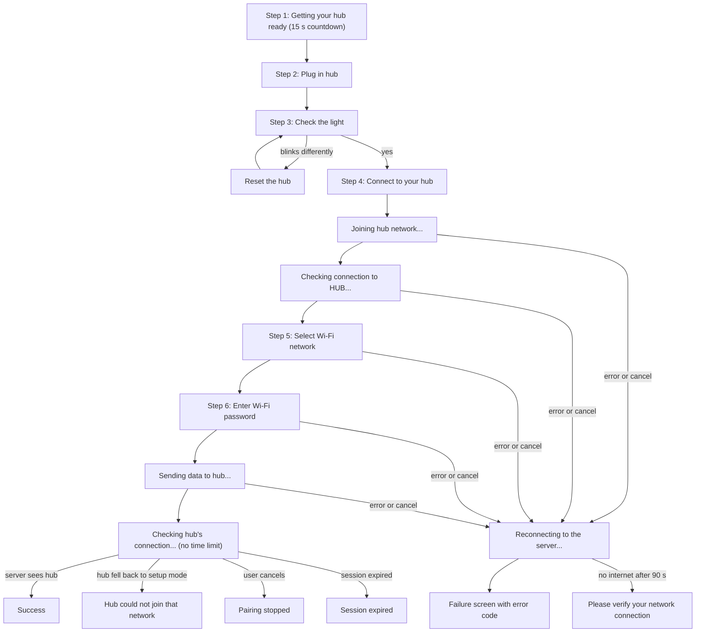

# 11 — Connect a Hub to Wi-Fi (Hub Pairing)

## In short

A new hub does not know the home Wi-Fi. When it is powered on unconfigured, it creates its own
small Wi-Fi network called **"Cartell Hub" followed by its MAC address**. Pairing is a guided wizard in which:

1. the user confirms the hub is plugged in and blinking correctly,
2. the **phone leaves the home Wi-Fi and joins the hub's network**,
3. the hub lists the Wi-Fi networks it can see, and the user picks theirs and types the password,
4. the app sends the network name and password to the hub (encrypted),
5. the phone returns to the home Wi-Fi, and the app **waits until the server reports the hub
   online**.

It is the hardest thing the app asks of anyone. It is long, physical and often done outdoors, and
it can fail in many ways. Every failure has its own screen and error code.

| | |
|---|---|
| **Who** | Homeowners setting up a new hub, or repairing one that went offline |
| **Where** | "Hub Added to Account!" → **Proceed and Pair To Wi-Fi**; or Hub details → **Connect HUB** (only enabled while the hub is disconnected) |
| **Flutter source** | `screens/devices/connect_hub_to_wifi/**` (state machine, 21 events, 19 screens, poller, probes), `components/pairing/pairing_step_scaffold.dart`, `components/hub_light_widget.dart`, `udp_commands/**`, `services/encryption.dart`, `services/requests/device_requests.dart` (`probeHubRegistration`) |
| **Detailed spec** | `docs/spec/16-hub-pairing.md` (full state machine) · `17-udp-protocol-and-crypto.md` (hub messages and encryption) |
| **Porting plan** | Phase 2 (2.1, 2.2 risk spikes), Phase 15 |
| **Hardware notes** | Root `CLAUDE.md` → "Measured hub behaviour"; `frontend/docs/superpowers/DEVICE-VERIFICATION-427.md` |

## The journey

## What the user sees (screen by screen)

All pairing screens share one layout: the top bar with the logo but **no menu**, a small grey
**"Step N of 6"** line on the six numbered steps, a picture or animation, a bold title, an optional
subtitle, then the buttons. Some screens have an amber round **?** button at the bottom-right
("Help with this step") that opens an explanation. The exit button is **Cancel** on most steps and
**Return to Devices** on the first step and the end screens.

Screens change instantly between steps, with no animation.

### Step 1 of 6 — "Getting Your Hub Ready"

- Subtitle: "Your hub needs a moment to switch into pairing mode. Start Pairing turns on when it
  is ready."
- A blue ring counts down **15 seconds** with the number in the middle. At 0 the number becomes an
  amber ✓.
- **Start Pairing** (amber) is disabled until the countdown ends → Step 2.
- **Return to Devices** → Hubs list.

### Step 2 of 6 — "Plug in Hub"

- Subtitle: "Is your hub plugged in?" Picture: a power-plug icon in a ring.
- **Yes** → Step 3. **Cancel** → Hubs list.
- **?** help: "Plugging In Your Hub" / "Connect the power adapter to your hub and plug it into a wall
  outlet. Your hub needs to stay plugged in from now on. It is what keeps your sensors talking to
  Cartell. Once it has power, a light next to the antenna will start to blink. Contact support if
  no light comes on at all." (**Got it**)

### Step 3 of 6 — "Check the Light on Your Hub"

- Subtitle: "Does your Hub's light blink like this?" An **animated light** shows the expected
  pattern: a short green flash every 3 seconds (the hub's setup mode).
- "(The light should be located next to the antenna)"
- **Yes** → Step 4.
- **It blinks differently** → popup **"Reset Your Hub?"** / "Resetting erases the Wi-Fi settings
  stored on your hub so it can start pairing again. Your account and your sensors are not
  affected. If your hub is already working on another network, resetting it will disconnect it."
  with **Keep trying** (closes) and **Reset the hub** → the Reset screen.
- **I can't find the light** → popup **"Finding the Light on Your Hub"** / "The light sits next to
  the antenna. It is small, and in daylight you may need to shade it with your hand. Make sure the
  hub is plugged in and has had a few seconds to start up. If you still cannot see any light at
  all, contact support." with **Look again** and **Contact support**. **Contact support** only
  closes the popup (Q1).
- **?** help: the same "Finding the Light" text.

### Reset screen (not numbered) — "Hold the Reset Button In"

- Animated light: fast red flashing (the hub's reset pattern).
- "Find the reset button on your hub and hold it in until the light blinks like above. Then
  release the button. Your hub's Wi-Fi settings are now reset."
- 'Once your hub has reset, press "The Hub Reset" below.'
- For the first **3 seconds** a progress bar runs; then the **The Hub Reset** button appears → back
  to Step 3.

### Step 4 of 6 — "Connect to Your Hub"

- Subtitle: "Connect to the WiFi signal of the HUB." Picture: Wi-Fi icon.
- "Before you press the button, have your Wi-Fi password ready. Please ensure your network is
  2.4GHz before proceeding."
- **Android only**: if the phone's Wi-Fi is switched off (checked on opening and whenever the app
  returns to the foreground), an amber box warns "Your WiFi is turned off. Please enable WiFi to
  connect to your Hub." and the button is disabled.
- **Connect to Hub** (amber) → the phone starts joining the hub's network.
- **?** help: "Connecting to Your Hub" / explains the phone will ask permission to join a network
  named "Cartell Hub" plus the MAC address, that the phone leaves the home Wi-Fi meanwhile and
  rejoins on its own afterwards, and what to check if no prompt appears.

### Step 4 (waiting) — "Connecting to HUB"

- Subtitle: "Your phone has to join the HUB's own network for this step." Spinner.
- 'Tap "Join" if your phone asks for permission.' (iOS) or 'Tap "Connect" ...' (Android), and
  "Your phone may ask each time it joins a HUB. Pairing cannot continue until you answer."
- The **phone's own prompt** appears here: iOS "Wants to join Wi-Fi network ... **Join**", Android
  "Connect to device ... **Connect**". It only appears on a phone that has not approved this hub
  before.
- **Cancel** (asks "Stop Pairing?" first).
- **?** help: "Joining the HUB's Network" / explains that the phone leaves the home network and
  asks permission first, that an unanswered prompt makes this step time out, and that someone who
  already tapped Cancel on the prompt should cancel and begin again. (**Got it**)

### Step 4 (waiting) — "Checking Connection to HUB"

- Spinner. The app is now talking to the hub directly. No buttons except **Cancel**.

### Step 5 of 6 — "Select WiFi Network"

- Subtitle: "Choose the Wi-Fi network you want your hub to use. It must be a 2.4GHz network."
- The list fills in as the hub reports networks, each with its name and a signal-strength icon
  (full, two bars, or one bar). While the list is empty for the first 8 seconds: spinner and
  "Looking for networks...". If still empty after that: "No networks found" / "Your hub can only
  see 2.4GHz networks. Check your router settings, then scan again."
- "If your network does not appear in the list, it may not be a 2.4GHz network. Please check your
  router settings and ensure your network is set to 2.4GHz."
- **Refresh Wifi Networks** clears the list and asks the hub to scan again.
- Tapping a network → Step 6.

### Step 6 of 6 — "Login To WiFi Network"

- A large Wi-Fi icon showing the network's signal strength. "Name: <network name>".
- Password field ("Enter network password"), hidden, with an eye button. The phone's password
  manager and autocorrect are switched off for this field. This is the only field in the app
  with a plain underline instead of an amber rounded outline (Q37).
- As the user types, if the password is longer than the hub can store (more than **64 bytes**;
  accented letters and emoji count as several), the field shows "This password is too long for the
  hub, which stores 64 characters. Accented and emoji characters use more than one each." and
  **Connect** is disabled.
- **Connect** (amber):
  - with a password → sends it to the hub
  - with an **empty** password → popup **"Connect without a password?"** / "<network> will be
    joined as an open network, so anyone nearby can see the traffic between your hub and your
    router." → **Go back** or **Connect anyway**.
- **Back to networks** → Step 5 with a fresh scan.
- There is no Cancel button on this screen (Back and the system gesture still ask "Stop Pairing?").
- Developer builds also show the signal strength in dB and a **Scan QR Code Password - Debug
  Only** button that reads a password from a QR code.

### Step 6 (waiting) — "Sending data to Hub"

- Spinner and **Cancel**. The app sends the encrypted name and password every 4 seconds until the
  hub confirms receipt.
- Once the hub acknowledges, the app waits about 5 seconds, then **leaves the hub's network**, and
  the phone returns to its normal Wi-Fi.

### Step 6 (waiting) — "Checking Hub's connection..."

The app now asks the server, again and again, whether the hub has come online. **There is no time
limit**; it keeps checking until one of the outcomes below happens or the user cancels.

- Spinner, then one status line with an icon, which changes as things happen:

  | Status line | Meaning |
  |---|---|
  | "Reconnecting your phone to your wifi network." | The phone is still on the hub's network |
  | "Waiting for your hub to reach our servers." | The server answered: hub not online yet |
  | "Having trouble reaching Cartell. Still trying." | The phone cannot reach the server |
  | "Checking on your hub." | The one-time hub check (below) is running |
  | "Still waiting for your hub." | That check found the hub silent |

- "m:ss elapsed" ticking every second. From 1 minute on: "This can take a few minutes."
- After the one-time hub check finds the hub silent, a **light guide** appears: "Your hub has not
  reached us yet. The light on it says what is happening." with four rows: no light ("No power.
  Check that it is plugged in."), solid green ("Already set up. Check your Devices list."), solid
  blue ("On your Wi-Fi, but that network has no internet."), and the slow green flash ("Still
  waiting for setup. Try pairing again.").
- **Cancel** → "Stop Pairing?" → **Pairing stopped** screen.

**How often it checks:** every 2 s for the first 3 checks, then every 5 s (checks 4–6), every
15 s (7–12), then every 60 s. While the app is in the background it only waits, re-checking every
5 seconds whether it has come back.

**The one-time hub check:** about **60 seconds** after the hub acknowledged the password (and only
while the app is on screen), the phone briefly **re-joins the hub's network** and asks the hub for
its firmware version, waiting up to 8 seconds:

- **The hub answers** → it must have gone back to setup mode, which means the Wi-Fi details were
  wrong → **"Your hub could not join that network"**.
- **No answer** → the hub is not in setup mode (it may have joined, or be slow), so checking
  continues and the light guide appears.

This works because, as measured on real hardware, a hub given a wrong password still acknowledges
it, then falls back to setup mode about 10 seconds later. A hub given the right password stops
answering on its setup network for good.

## How it ends

| Outcome | Screen | Buttons |
|---|---|---|
| Server reports the hub online | ✓ "Hub has successfully connected to the network." | **Continue** → (feedback prompt, see [26](26-feedback.md)) → Hubs list |
| Hub fell back to setup mode | "Your hub could not join that network" / "It went back to waiting for setup, so the details it was given did not work." Bullets: "The Wi-Fi password, which is the usual cause.", "That the hub is close enough to your router.", "That your router is powered on and its network is up." | **Try Again** → Step 1; **Return to Devices** |
| User cancelled while waiting | "Pairing stopped" / "Your hub may already be connected. Check your Devices list before pairing again." and "Code: e5b1907d-C" | **Return to Devices** (shown first); **Begin Pairing Again** → Step 1 |
| Session expired while waiting (3 failed session checks in a row) | Failure screen: "Your session has expired. Please sign in again to finish setting up your hub." Error `e5b1907d-A` | as for failures |
| Any error during steps 4–6, or cancelling them | First **"Reconnecting to the server" / "Please wait"** with a spinner while the phone returns to its own Wi-Fi (up to 90 seconds), then the **failure screen** | see below |

### The failure screen

Large Wi-Fi-off icon, the error message as the title, an optional explanation, **Begin Pairing
Again** (→ Step 1), **Return to Devices**, and "Error: <code>" in small grey text.

| Code | Message | Cause |
|---|---|---|
| `762c844a-0` | "Your phone never reached the HUB." + 'If your phone asked for permission to join a network, that prompt may still be waiting, or it may have been dismissed. Try again, and tap "Join/Connect" when you see it.' | 40 seconds of messages to the hub with no reply at all |
| `762c844a-1` (`-2`, `-3` in developer builds) | "The connection to your hub could not be verified. Please try again." | The hub replied but verification did not complete in 40 s |
| `762c844a-W` | same message | The hub sent an unexpected message |
| `762c844a-S` | "Could not open a connection to your hub. Please try again." | The phone could not open its local network port |
| `9d5a3474` | "We weren't able to connect to your hub. Please try again later." | Every message to the hub failed to send |
| `8874c4b9` | "Connection is unreliable. Please try again." | More than 12 send failures |
| `dbd39a14-b708` | "We weren't able to connect to your hub. Please try again later." | The hub never acknowledged the Wi-Fi details (about 20 s) |
| `3b3cd169-f023` | same message | Credential sending ran out (rarely reachable) |
| `e5b1907d-J` / `-V` / `-N` / `-K` / `-S` / `-R` | "Pairing was cancelled. Please try again later." | User stopped pairing while joining (J), verifying (V), choosing a network (N), entering the password (K), sending (S), or reconnecting (R) |
| `d63f9b07` | "Pairing was cancelled. Please try again later." | **Cancel** on the "Reconnecting to the server" screen when no clean-up was running |
| `e5b1907d-A` | session expired text above | |

If the phone still cannot reach the server after **90 seconds**, the user sees **"Please verify
your network connection and try again"** with **Try Reconnecting Again**. That retries for another
90 seconds and, on success, shows ✓ "Successfully reconnected to the server." → **Continue** →
Hubs list.

## Leaving part-way

- On Steps 1–4 (before the phone joins the hub) and on every end screen, **Cancel**, **Return to
  Devices**, ← and Android Back go straight to the Hubs list.
- From "Connecting to HUB" onwards, they first ask **"Stop Pairing?"** / "Your hub is part-way
  through setup. If you stop now it may not connect, and you will need to start again." with **Keep
  pairing** and **Stop pairing**. Stopping cleans up (phone leaves the hub's network), then shows
  the failure screen with an `e5b1907d-...` code, or "Pairing stopped" if it was waiting for the
  server.
- **Cancel** on "Reconnecting to the server" stops the 90-second wait early.

## While pairing, the rest of the app holds back

From the moment the phone starts joining the hub's network until pairing ends:

- the 15-second maintenance check is paused, so the "can't reach Cartell" screen does not take
  over while the phone is deliberately offline (see [07](07-maintenance-and-no-connection.md))
- the "you are on a hub's network" guard only leaves a note instead of an error report
- the Android app is bound to Wi-Fi, so the hub's network (which has no internet) is used anyway

## What the app sends to the hub (local network, not the server)

The phone talks to the hub at `192.168.4.1`, UDP port `5002`, and listens for replies on port
`6452`. Every message is a small binary packet with a fixed header (`DE AD BE EF`), a type, a
length and a checksum. Full byte layout: `docs/spec/17-udp-protocol-and-crypto.md`.

| Message | When | Hub replies with |
|---|---|---|
| Get firmware version | Twice a second while verifying (up to 80 times), and in the one-time hub check | its firmware version number |
| Save WebSocket address | Right after verification, three times (0, 120, 240 ms); tells the hub which server to talk to: `wss://<server>/hub/` | nothing awaited |
| Scan Wi-Fi networks | On Step 5, and every 10 s until something is found | one reply per network: name, signal strength (RSSI), channel |
| Check and save Wi-Fi details (encrypted) | Every 4 s on "Sending data to Hub" | an acknowledgement (always "1", even for a wrong password) |

The Wi-Fi name and password are each padded to 64 bytes and encrypted with **AES-128** using a key
and IV built into the app (and mirrored by the server's test tools). They never travel in plain
text.

The hub's own network is joined with the fixed password `family12`, one-time only, and marked "no
internet".

## What the app asks of the server

| When | Request | Expects |
|---|---|---|
| Entering pairing | `POST /devices/{id}/message/get_health/`, `GET /devices/{id}/` | the hub's record (to get its MAC address) |
| Waiting for the hub | `GET /devices/{id}/` repeatedly | `device.is_connected` = true means success |
| Reconnecting after an error | `GET /test/` repeatedly for up to 90 s (1 s apart at first, then 2 s, then 5 s) | *any* answer at all means the server is reachable |

## Error reports sent while pairing

Every failure is reported to Sentry with its code. Notes are attached for each step (verification
timed out, unexpected message, credentials acknowledged, server check unavailable). Once per
waiting phase, a summary is sent: outcome, how many checks ran, whether the server was ever
reached, elapsed time and why checks failed. See [31](31-error-reporting-and-logging.md).

## Odd but true

- **Q1**: "Contact support" in the light-finding popup only closes the popup.
- **Q37**: the Wi-Fi password field looks different from every other field in the app.
- **Q38**: a "Your Hub is added to your account. To connect, tap Return..." line exists on the
  failure screen but is never shown.
- **The hub's acknowledgement means nothing about the password.** A wrong password is only
  discovered by the one-time hub check about a minute later.
- **The phone's Wi-Fi approval prompt is only shown once per hub.** On a phone that has paired that
  hub before it is skipped, which is why testers rarely see it.
- **Release builds skip two verification stages** (reading and comparing the hub's stored server
  address) that developer builds run. In release, the address is simply written.
- The debug server-picker warns: "When using Beta or Production environments, pairing new hubs to
  the server will not work." See [29](29-environments-and-test-builds.md).

## Related

- [10 Add a hub](10-add-a-hub.md) · [12 Hub details](12-hub-details.md) ·
  [28 Hub light guide](28-hub-light-guide.md) · [32 Wi-Fi and location permissions](32-permissions-and-platform-behaviour.md)
