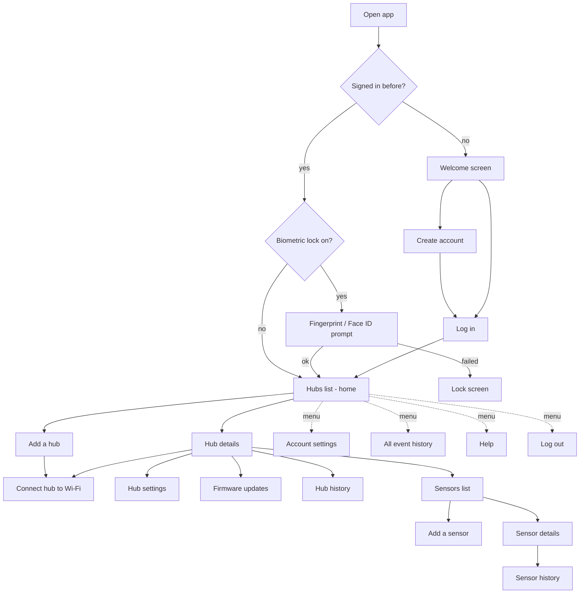

# Cartell Mobile App: Feature Guide

This folder explains **what the current Cartell mobile app does**, one feature at a time. It
covers what the user sees, what happens on every tap, what the app asks of the server, and what
happens when something goes wrong.

It describes the shipping **Flutter app** (`frontend/`, version `1.12.5+193`), read from its source
code on 2026-10-06. Only the mobile app is described here. The server (`backend/`) appears only as
"the app calls this address and expects this back".

## How this fits with the other documents

| Document | Question it answers | Organised by |
|---|---|---|
| **This folder** (`docs/features/`) | *What does the app do, and how?* | Feature / use case, in the order a user meets them |
| `docs/spec/` | *Exactly how is each part built?* (pixel sizes, widget trees, state machines) | Technical layer |
| `PORTING_PLAN.md` | *In what order do we rebuild it in React Native?* | Build phase |

Every feature page links to the matching spec section and porting-plan phase, so you can go from
"what it does" to "how exactly it is built" to "when we build it".

## About Cartell in two paragraphs

Cartell is a **vehicle-detection alert system** for homes. A **hub** plugged in at the property
connects to the home Wi-Fi. One or more wireless **sensors** sit along a driveway or gate and talk
to the hub by radio. When a sensor detects a vehicle, the server sends the homeowner a **push
notification**. There are no cameras and no recordings: the product is the alert.

The mobile app is how the homeowner **sets the system up and looks after it**. They create an
account, add a hub, connect the hub to Wi-Fi (the hardest part), pair sensors, place sensors on a
map, choose who gets which alerts, look at the history of detections, and update firmware. Most
days the app is not opened at all, because the notification does the job.

## The user journey at a glance

If the diagram does not render in your viewer, the same journey is spelled out in the table
below. The numbers follow the order a user meets each feature.

## Feature catalogue

### A. Getting in

| # | Feature | One-line summary |
|---|---|---|
| 01 | [App start and automatic sign-in](01-app-start-and-automatic-sign-in.md) | What happens from tapping the icon to landing on a screen |
| 02 | [Welcome screen and "Open Debug Info"](02-welcome-screen-and-debug-info.md) | First screen for signed-out users; version info, connection test, environment switch |
| 03 | [Create an account (register)](03-create-an-account.md) | Six-field sign-up form with live password rules |
| 04 | [Log in](04-log-in.md) | Email and password login, Forgot Password, password manager, biometric offer |
| 05 | [Biometric unlock (fingerprint / Face ID)](05-biometric-unlock.md) | Optional lock that asks for a fingerprint or face each time the app opens |
| 06 | [Staying signed in, and logging out](06-session-and-log-out.md) | How the session is kept alive, refreshed, expired and ended |
| 07 | [Server maintenance and "can't reach Cartell"](07-maintenance-and-no-connection.md) | Full-screen takeovers when the server is down or unreachable |

### B. Getting around

| # | Feature | One-line summary |
|---|---|---|
| 08 | [Navigation menu, screen layout and Back](08-navigation-and-screen-layout.md) | The side menu, app bar, tablet layout, Back button and screen transitions |

### C. Hubs

| # | Feature | One-line summary |
|---|---|---|
| 09 | [Hubs list (home screen)](09-hubs-list.md) | All hubs on the account, with connection status |
| 10 | [Add a hub](10-add-a-hub.md) | Register a hub to the account by QR code or typed MAC address |
| 11 | [Connect a hub to Wi-Fi (pairing)](11-connect-hub-to-wifi.md) | Six-step wizard that hands the hub the home Wi-Fi details |
| 12 | [Hub details](12-hub-details.md) | One hub's status and its action buttons |
| 13 | [Hub settings](13-hub-settings.md) | Five on/off switches per hub (onboard sensor, integrator, alerts, email) |
| 14 | [Rename, view info about, or delete a hub](14-rename-about-and-delete-a-hub.md) | The hub's three-dot menu |
| 15 | [Firmware updates](15-firmware-updates.md) | Check for and install new hub software, with live progress |

### D. Sensors

| # | Feature | One-line summary |
|---|---|---|
| 16 | [Sensors list](16-sensors-list.md) | The sensors paired to one hub |
| 17 | [Add (pair) a sensor](17-add-a-sensor.md) | Three-screen wizard: name it, open it, press its button |
| 18 | [Sensor details](18-sensor-details.md) | Battery, map, history, alerts switch, "Pair Sounder" |
| 19 | [Sensor location, rename, info and delete](19-sensor-location-rename-about-delete.md) | Place a sensor on the map, rename it, see when it was paired, remove it |

### E. Alerts and history

| # | Feature | One-line summary |
|---|---|---|
| 20 | [Push and in-app notifications](20-notifications.md) | How alerts reach the phone, permission prompts, token registration |
| 21 | [Event history](21-event-history.md) | Every detection, connection and disconnection, for the account, a hub or a sensor |

### F. Account and help

| # | Feature | One-line summary |
|---|---|---|
| 22 | [Account settings](22-account-settings.md) | Profile overview, account-wide alert switches, biometric switch |
| 23 | [Edit name, phone number and password](23-edit-name-phone-and-password.md) | The three edit forms |
| 24 | [Delete account](24-delete-account.md) | Permanently remove the account |
| 25 | [Help screen](25-help-screen.md) | App version, support links |
| 26 | [Send feedback](26-feedback.md) | Five-face rating and comment, sent to the team |
| 27 | [Alexa voice commands](27-alexa-voice-commands.md) | Guide to the Cartell Alexa skill and a link to enable it |
| 28 | [Hub light guide](28-hub-light-guide.md) | What each blink pattern on the hub means (developer builds only) |

### G. Across the whole app

| # | Feature | One-line summary |
|---|---|---|
| 29 | [Environments and test builds](29-environments-and-test-builds.md) | Which server the app talks to, the red "TEST SERVER" tag |
| 30 | [How the app talks to the user: popups, toasts and banners](30-popups-toasts-and-banners.md) | The four kinds of message and how each behaves |
| 31 | [Error reporting, crash reports and logs](31-error-reporting-and-logging.md) | What is sent to Sentry, error codes, privacy |
| 32 | [Phone permissions and platform behaviour](32-permissions-and-platform-behaviour.md) | Camera, location, Wi-Fi, notifications, text size, rotation, iOS vs Android |

### Appendices (reference)

| # | Appendix | What it holds |
|---|---|---|
| A1 | [Server API reference](A1-server-api-reference.md) | Every server address the app calls, what it sends and expects, and which feature uses it |
| A2 | [Data kept on the phone](A2-data-kept-on-the-phone.md) | What is stored, where, and when it is wiped |
| A3 | [Screen index](A3-screen-index.md) | Every screen in the app, how to reach it, and its feature page |
| A4 | [Hidden, unfinished and unused features](A4-hidden-and-unused-features.md) | Code that exists but no user can reach |
| A5 | [Message catalogue](A5-message-catalogue.md) | Every popup, toast and error message, word for word |
| A6 | [Source file coverage](A6-source-file-coverage.md) | All 266 Flutter source files, each mapped to the page that covers it (proof nothing is missed) |

## How to read a feature page

Every page has the same sections, so you can skip to what you need:

1. **In short**: what the feature is for, in plain words.
2. **Where to find it**: how a user gets there.
3. **What the user sees**: the screen, top to bottom.
4. **What happens when...**: every tap, swipe and automatic action, and its result.
5. **What the app asks of the server**: the addresses called, what is sent, and what is expected.
   Technical, but kept short.
6. **When something goes wrong**: each failure and the exact message shown.
7. **Odd but true**: behaviour that looks like a bug or surprise but is how the app works today.
   These matter for the React Native copy, which reproduces them unless the client approves a fix
   (see `docs/spec/19-quirks-register.md`; items are tagged **Q1**, **Q2** and so on).
8. **Related**: links to neighbouring features, the detailed spec and the porting-plan phase.

## Conventions

- Text in **"double quotes"** is the exact wording on screen, typos included (for example
  "An Error Occured"). The React Native app must use the same wording.
- **Button names** are shown in bold, for example **Log In**.
- **Toast**: a small message that drops in at the top of the screen and fades after a few seconds.
  **Popup**: a centred dialog box that must be answered. See [30](30-popups-toasts-and-banners.md).
- **Server addresses** are written as `GET /devices/`, and are relative to the current server, for
  example `https://cartellap.com/devices/`. Trailing slashes are exactly as the app sends them.
- **Hub** is the device on the wall. **Sensor** is the device by the driveway. **Event** is one
  entry in the history (a detection, a connection or a disconnection).

## Glossary

| Term | Meaning |
|---|---|
| Access point (AP) | The temporary Wi-Fi network a hub broadcasts while it waits to be set up. Its name is "Cartell Hub" followed by the hub's MAC address. |
| Blacklisted / flagged | The server has marked a hub or sensor for suspicious activity. The app shows warnings and asks the user to contact support. |
| Controller / Transmitter | The two chips in a hub that each run their own firmware: the controller (ESP32 chip) and the transmitter (RFM6601 radio chip). |
| FCM token | The address Google/Apple use to deliver push notifications to this phone. The app registers it with the server. |
| Firmware | The software that runs inside the hub. |
| Integrator | An external device, typically a gate opener, that the hub can trigger. "Integrator support" is a per-hub switch. |
| JWT / access token / refresh token | The two keys that keep a user signed in. The access token is short-lived; the refresh token lasts about 180 days and is replaced each time it is used. |
| MAC address | A hub's unique hardware ID, such as `48:27:E2:B1:94:44`. Printed on the hub as a QR code. |
| Onboard sensor | A sensor built into the hub itself, which can be switched on in Hub settings. |
| Pairing (hub) | Giving the hub the home Wi-Fi name and password so it can reach the server. See [11](11-connect-hub-to-wifi.md). |
| Pairing (sensor) | Linking a new wireless sensor to a hub. See [17](17-add-a-sensor.md). |
| Sentry | The third-party service that receives crash reports, error reports and user feedback. |
| Sounder | An add-on unit that makes a sound when a sensor fires. Paired from the onboard sensor's screen. |
| UDP | The low-level network messages the app sends directly to a hub on the local Wi-Fi during pairing. |
